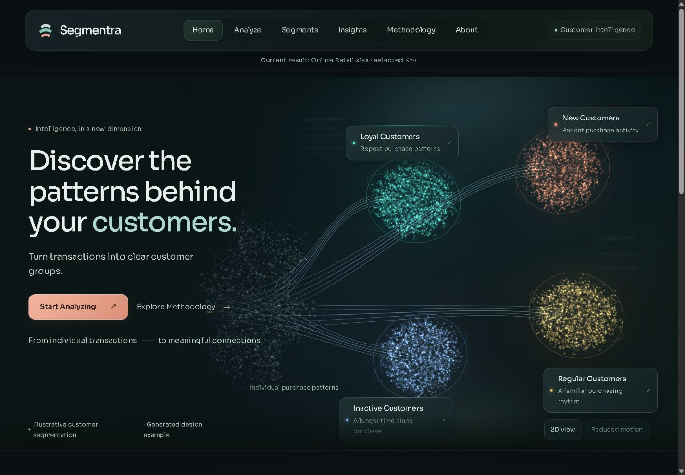
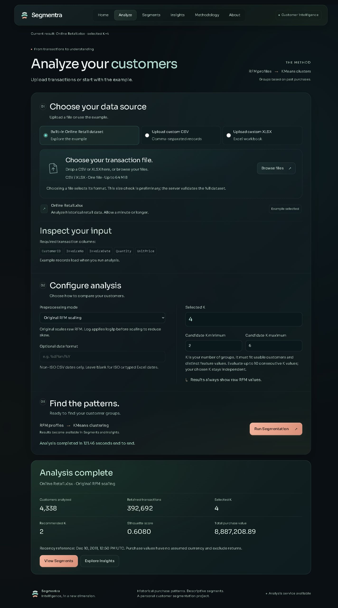
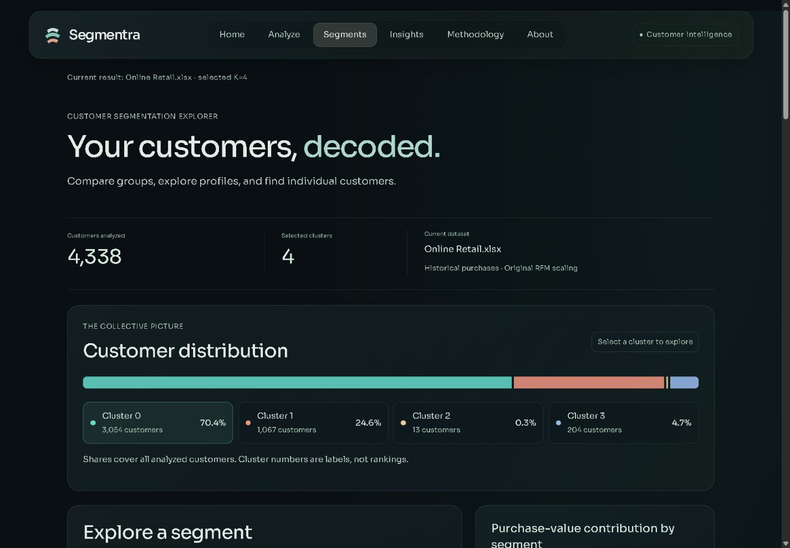
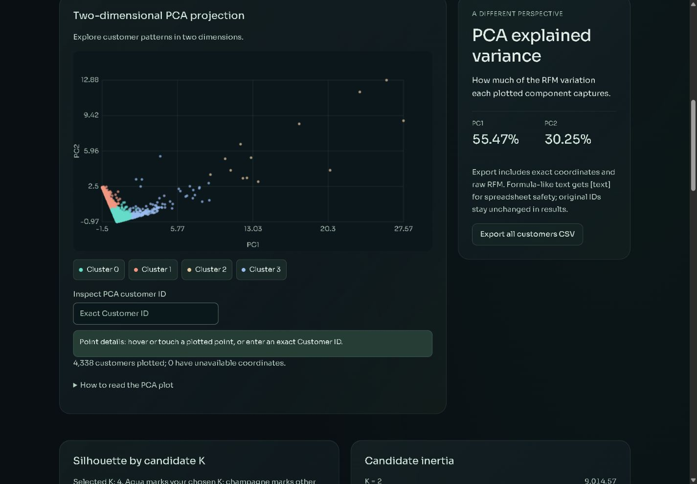

# Segmentra

**Customer Segmentation & Behavioral Intelligence Platform**

Turn transaction history into customer groups you can explore. Segmentra combines purchase-only RFM features with unsupervised KMeans clustering, then lets you compare profiles, inspect customers and review model quality through a responsive React interface.



[Features](#features) · [Local setup](#local-setup) · [How it works](#how-it-works) · [Dataset](#dataset-and-attribution) · [Deployment](#deployment-status)

## Features

- Upload CSV or XLSX transactions, or run the included Online Retail example.
- Build Recency, Frequency and Monetary profiles with explicit cleaning rules.
- Choose raw RFM scaling or log-transformed scaling, your K, and a candidate evaluation range.
- Compare customer counts, purchase-value contributions, and mean/median RFM by segment.
- Search, sort and filter individual customers; inspect PCA coordinates by customer ID.
- Review silhouette scores, candidate inertia, PCA explained variance and cleaning summaries.
- Download spreadsheet-safe customer and segment CSV exports.
- Explore six responsive pages, with keyboard controls, reduced-motion support and an SVG fallback for the illustrative WebGL Home scene.

## Application preview

Screenshots show the current application. Analytical values come from a real run of the attributed public UCI example; the Home scene is explicitly illustrative.

| Analyze | Segments |
| --- | --- |
|  |  |



## Technology

| Area | Implementation |
| --- | --- |
| Frontend | React, TypeScript, React Router, Vite; Sora typography and custom responsive CSS |
| Backend | Python, FastAPI, Pydantic, Uvicorn; bounded multipart ingestion |
| Machine learning | pandas, NumPy, scikit-learn: StandardScaler, KMeans, silhouette and PCA |
| Visualization | Custom WebGL/SVG particle scene, Canvas PCA plot, SVG candidate chart and HTML distribution charts |
| File processing | openpyxl with defusedxml for XLSX; PapaParse for preliminary browser CSV preview |
| Testing | pytest and HTTP API tests; Vitest, Testing Library and jsdom |

## How it works

**Transactions → Cleaning → RFM → Preprocessing → KMeans → Evaluation → Exploration**

| Signal | Meaning |
| --- | --- |
| Recency | Whole elapsed days since the latest retained purchase, relative to one day after the dataset's latest retained transaction. |
| Frequency | Distinct purchase invoices per customer. |
| Monetary | Sum of retained positive quantity × unit price. Returns are excluded; this is purchase value, not net revenue. |

The engine removes missing customer IDs, uppercase `C` cancellation invoices, nonpositive quantities/prices and exact duplicate source rows. It scales raw RFM or `log1p(RFM)` before scaling. KMeans uses `k-means++`, seed 42 and 10 initializations.

Candidate K values are compared by valid silhouette scores; your selected K stays independent of the recommendation. Evaluation uses at most 1,000 customers and the same seeded subset for every candidate. PCA provides a two-dimensional view; it is not the clustering input. Profiles and personas describe historical behavior, not churn or revenue predictions.

Open **Methodology** in the app for formulas, sampling rules and analytical caveats. See [API documentation](docs/technical/API.md) for request and response details.

## Project structure

```text
customer-segmentation/
├── frontend/
│   ├── src/app/          # Router and shared shell
│   ├── src/pages/        # Six application pages
│   ├── src/components/   # Analysis, charts, segment explorer and Home scene
│   ├── src/context/      # In-memory analysis state
│   ├── src/services/     # API client and contract integration
│   ├── src/styles/       # Approved visual identity and shared typography
│   └── src/test/         # Frontend regression tests
├── backend/             # FastAPI routes, validation and analysis service
├── segmentation/        # Independent Python RFM/ML engine
├── tests/               # Python and API security tests
├── tools/               # Optional full-workbook validation
├── docs/
│   ├── technical/       # Architecture, ML, API, security, deployment and dataset
│   ├── development-history/ # Concise milestones; local originals are ignored
│   └── screenshots/     # Current public application screenshots
├── Online Retail.xlsx   # Attributed public example, inherited in Git
├── pyproject.toml
└── requirements-backend.txt
```

Original Streamlit entry points (`app.py` and `main.py`) are retained for project history. The React application calls `backend.main:app`; it does not use those legacy entry points.

## Local setup

Use **Python 3.12** and **Node.js 24+** for the validated setup (the Python package declares support for 3.11+). The following commands use Windows PowerShell. On macOS/Linux, replace `.venv\Scripts\python.exe` with `.venv/bin/python` and use your shell's environment-variable syntax.

### 1. Clone and install the backend

```powershell
git clone https://github.com/JayantBansal900/customer-segmentation.git
Set-Location customer-segmentation
python -m venv .venv
.\.venv\Scripts\python.exe -m pip install -r requirements-backend.txt
.\.venv\Scripts\python.exe -m pip install -e ".[backend,test]"
```

`requirements-backend.txt` records the validated runtime versions. The editable installation adds the local packages and test dependencies. Validate installation on your own operating system; numerical libraries may require different wheels.

### 2. Start FastAPI

Run from the repository root:

```powershell
$env:OMP_NUM_THREADS = "1"
$env:OPENBLAS_NUM_THREADS = "1"
$env:MKL_NUM_THREADS = "1"
.\.venv\Scripts\python.exe -m uvicorn backend.main:app --host 127.0.0.1 --port 8000 --workers 1
```

Health: `http://127.0.0.1:8000/api/health`. The backend reads process environment variables, **not** dotenv files automatically. Defaults support local development; [backend/.env.example](backend/.env.example) documents optional upload, concurrency and CORS settings. Keep the example workbook at the repository root for example analysis.

### 3. Start the frontend in another terminal

```powershell
Set-Location customer-segmentation\frontend
npm ci
Copy-Item .env.example .env.local
npm run dev
```

Open **http://127.0.0.1:5173**. If this terminal is already at the repository root, use `Set-Location frontend` instead. Vite loads `.env.local`; the example uses an empty browser API base and a development proxy to port 8000. `VITE_*` values are public browser configuration and must never contain secrets.

## Usage and input

1. Open **Analyze** and choose the example or upload one CSV/XLSX file.
2. Choose preprocessing, selected K and the candidate K range.
3. Run segmentation and wait for the actual result.
4. Explore **Segments** and **Insights**, then export the records or profiles you need.

| Required column | Expected content |
| --- | --- |
| `CustomerID` | Customer identifier; keep leading zeros as text. Blank IDs are excluded during cleaning. |
| `InvoiceNo` | Purchase invoice identifier. |
| `InvoiceDate` | ISO date/time or a typed Excel date; supply an explicit format for non-ISO CSV dates. |
| `Quantity` | Finite numeric quantity. |
| `UnitPrice` | Finite numeric unit price. |

CSV must use UTF-8; XLSX reads the first worksheet. Other columns may be present. Invalid dates/numeric values, duplicate headers or missing required columns produce validation errors; transaction values are not imputed. The default upload limit is 64 MiB. K is bounded by usable customers and distinct feature vectors, and the API supports at most 10 candidate values per request.

Results stay in memory while navigating and reset on a full refresh. Changing analysis settings clears the previous result. Cancelling the browser wait does not stop server computation.

## Dataset and attribution

The repository retains the original **Online Retail.xlsx**, a public dataset by **Chen, D. (2015)** from the [UCI Machine Learning Repository](https://archive.ics.uci.edu/dataset/352/online+retail), DOI [10.24432/C5BW33](https://doi.org/10.24432/C5BW33). UCI licenses it under [CC BY 4.0](https://creativecommons.org/licenses/by/4.0/). The workbook is unmodified; Segmentra derives cleaned purchase profiles from it.

See [DATASET.md](docs/technical/DATASET.md) for provenance, attribution and deployment provisioning. If the workbook is missing from your checkout, download the official dataset and place the extracted workbook at the repository root. Private uploads and exports belong outside Git and static hosting.

Dataset licensing is separate from Segmentra source code. No source-code license has been selected; this README does not grant an open-source license. Sora's license and font source are retained in [frontend/public/fonts](frontend/public/fonts).

## Testing

From the repository root:

```powershell
.\.venv\Scripts\python.exe -m pytest
# Focused XLSX/CORS security regressions
.\.venv\Scripts\python.exe -m pytest tests/test_release_security.py
```

From `frontend`:

```powershell
npm test
npm run typecheck
npm run build
# Focused spreadsheet-safe export regressions
npm test -- src/test/csv-security.test.ts
```

Historical milestones are recorded in [development history](docs/development-history/DEVELOPMENT_SUMMARY.md), rather than promised as a permanent guarantee. The tests cover RFM semantics, cleaning, clustering, API validation, upload cleanup, prohibited XML, CORS, CSV security, frontend state, navigation and scene lifecycle behavior.

## Security and limitations

- XLSX uploads use active XML protection, archive checks and size budgets. CSV exports visibly prefix formula-like text with `[text] `; raw API/explorer identifiers stay unchanged. Import ordinary leading-zero IDs as text. See [export policy](docs/technical/SECURITY.md).
- Data quality, outliers and preprocessing affect clusters. Silhouette measures separation, not business usefulness; scores across different preprocessing spaces are not directly comparable.
- Large workbooks require significant CPU time and memory. Upload/ZIP budgets are not complete memory or computation-time bounds. One analysis is admitted per process by default.
- Personas describe retained purchases. No authentication, database, saved server-side analyses or background job queue is implemented.

## Deployment status

**Deployment is pending; no public application URL is available.** Local production builds have been verified. A chosen host still needs installation, resource-capacity, HTTPS, exact-origin CORS, request admission/rate limits, private temporary storage and SPA/API routing checks. Vite preview is a local validation server.

Review [DEPLOYMENT.md](docs/technical/DEPLOYMENT.md) before hosting. Public CORS configuration alone does not prevent abuse of unauthenticated computation.

## Author and repository

Maintained in [JayantBansal900/customer-segmentation](https://github.com/JayantBansal900/customer-segmentation) by [JayantBansal900](https://github.com/JayantBansal900). Repository history and original project files are preserved.

## Technical documentation

[Architecture](docs/technical/ARCHITECTURE.md) · [ML pipeline](docs/technical/ML_PIPELINE.md) · [API](docs/technical/API.md) · [Security](docs/technical/SECURITY.md) · [Deployment](docs/technical/DEPLOYMENT.md) · [Dataset](docs/technical/DATASET.md)
